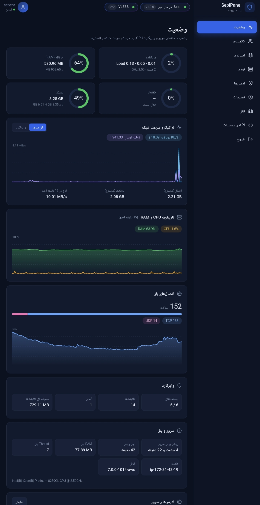
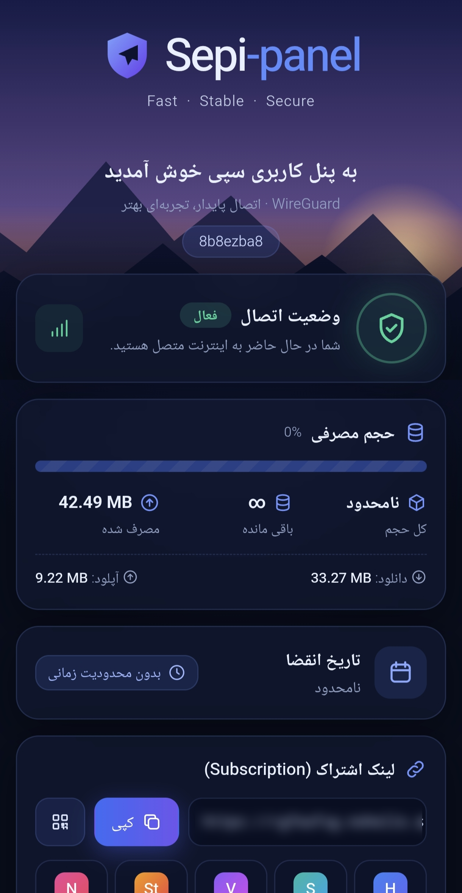

<div dir="rtl" align="right">

# 🛡️ SepiPanel

پنل مدیریت **چندپروتکلی VPN** در یک فایل پایتون؛ نصب تک‌خطی، رابط وب فارسی، مدیریت کاربر با حجم و انقضا، لینک اشتراک (Subscription) با **نام داینامیک**، چند ادمین (فروشنده)، API برای ربات و سایت، **نود خودکار** و **تانل ریورس خودکار** بین ایران و خارج.

[](LICENSE)


---

## 📑 فهرست

1. [امکانات](#-امکانات)
2. [تصاویر](#-تصاویر)
3. [پروتکل‌های پشتیبانی‌شده](#-پروتکل‌های-پشتیبانی‌شده)
4. [پیش‌نیازها](#-پیش‌نیازها)
5. [نصب](#-نصب)
6. [اولین ورود](#-اولین-ورود)
7. [آشنایی با بخش‌های پنل](#-آشنایی-با-بخش‌های-پنل)
8. [اینباندها (تنظیمات هر پروتکل)](#-اینباندها-تنظیمات-هر-پروتکل)
9. [کلاینت‌ها](#-کلاینت‌ها)
10. [لینک اشتراک (Subscription)](#-لینک-اشتراک-subscription)
11. [نام داینامیک کانفیگ‌ها](#-نام-داینامیک-کانفیگ‌ها)
12. [آیدی تلگرام و عنوان داخل ساب](#-آیدی-تلگرام-و-عنوان-داخل-ساب)
13. [ساب کاستوم و خارج‌کردن اینباند از ساب](#-ساب-کاستوم-و-خارج‌کردن-اینباند-از-ساب)
14. [محدودیت کاربر هم‌زمان](#-محدودیت-کاربر-هم‌زمان-max_users)
15. [ادمین‌ها (فروشنده‌ها)](#-ادمین‌ها-فروشنده‌ها)
16. [API و کلیدهای API](#-api-و-کلیدهای-api)
17. [افزودن نود (چند سرور)](#-افزودن-نود-چند-سرور)
18. [تانل ریورس خودکار (ایران ↔ خارج)](#-تانل-ریورس-خودکار-ایران--خارج)
19. [دامنه، SSL و تنظیمات پنل](#-دامنه-ssl-و-تنظیمات-پنل)
20. [منوی مدیریت ترمینال](#-منوی-مدیریت-ترمینال)
21. [فایروال و پورت‌ها](#-فایروال-و-پورت‌ها)
22. [بکاپ و بازیابی](#-بکاپ-و-بازیابی)
23. [آپدیت](#-آپدیت)
24. [حذف](#-حذف)
25. [امنیت](#-امنیت)
26. [عیب‌یابی](#-عیب‌یابی)
27. [سؤالات متداول](#-سؤالات-متداول)
28. [ساختار فایل‌ها و مسیرها](#-ساختار-فایل‌ها-و-مسیرها)
29. [مجوز و سلب مسئولیت](#-مجوز-و-سلب-مسئولیت)

---

## ✨ امکانات

**مدیریت سرویس**
- نصب و راه‌اندازی با **یک دستور**؛ بدون Docker و بدون Node.js (فقط Python + Flask + SQLite)
- رابط وب فارسی و راست‌چین با تم تیره
- ساخت **اینباند** از ۷ نوع: WireGuard، AmneziaWG، OpenVPN، L2TP/IPsec، VLESS، Shadowsocks، Trojan
- یک کلاینت می‌تواند عضو **چند اینباند** باشد (هر اینباند آی‌پی/کلید مخصوص خودش)
- صفحهٔ **وضعیت** لحظه‌ای سرور: CPU، رم، دیسک، سرعت شبکه و اتصال‌ها

**کاربران و فروش**
- حجم، تاریخ انقضا، آمار مصرف، وضعیت آنلاین، **قطع خودکار** با اتمام حجم/زمان
- ریست خودکار ترافیک (روزانه / هفتگی / ماهانه)
- **محدودیت کاربر هم‌زمان** برای هر کلاینت
- **ادمین‌ها (فروشنده‌ها)** با سقف حجم و زمان جدا
- **API Key** با سقف حجم/زمان، مستندات زندهٔ داخل پنل و نمونه کد برای ربات تلگرام/سایت
- جلوگیری از ساخت کلاینت تکراری با `external_id` (امن در برابر callback تکراری درگاه)

**لینک اشتراک**
- یک لینک برای همهٔ کانفیگ‌های کاربر روی همهٔ اینباندها و نودها
- خروجی‌های base64 / raw / conf / json / صفحهٔ وب زیبا با QR و آموزش
- **نام داینامیک** با قالب قابل تنظیم: `🟢 آلمان | 12.3 GB | 20 روز`
- هدرهای استاندارد حجم/انقضا برای اپ‌های کلاینت، عنوان قابل تنظیم، **آیدی کانال تلگرام** در صفحهٔ ساب
- ساب کاستوم (کانفیگ کامل JSON برای Xray)

**چند سرور**
- **افزودن نود:** فقط آدرس و رمز SSH؛ بقیه‌اش خودکار
- **تانل ریورس خودکار** (ایران ↔ خارج) بر پایهٔ BackPack با نصب و کانفیگ هر دو سمت

**امنیت و نگهداری**
- مسیر مخفی تصادفی، محدودکردن به IP، HTTPS (Let's Encrypt یا گواهی دلخواه)، قفل موقت بعد از چند ورود ناموفق
- بکاپ و بازیابی دیتابیس، فعال‌سازی BBR، باز کردن پورت فایروال، آپدیت با یک دستور
- منوی مدیریت ترمینال: `sepipanel`

---

## 📸 تصاویر

<table>
  <tr>
    <td align="center"><br><sub>تب وضعیت پنل</sub></td>
    <td align="center"><br><sub>صفحهٔ لینک اشتراک کاربر (QR، مصرف، انقضا)</sub></td>
  </tr>
</table>

---

## 🔌 پروتکل‌های پشتیبانی‌شده

| پروتکل | هسته | نکته |
|---|---|---|
| WireGuard | `wg` | اینترفیس `wg0`، `wg1` و …؛ NAT خودکار، IPv6، PSK، DNS، MTU، Pre/Post Up/Down |
| AmneziaWG | `awg` | وایرگارد مبهم‌سازی‌شده (ضد DPI)؛ نسخه‌های ۱.x، ۲.۰ و ۳.x؛ نصب با `AWG=1` |
| OpenVPN | `openvpn` | UDP یا TCP، CA اختصاصی، tls-crypt، نصب خودکار هنگام ساخت اینباند |
| L2TP/IPsec | `xl2tpd` + `strongSwan` | PSK؛ نصب با `L2TP=1` یا خودکار |
| VLESS | Xray-core | Reality / TLS / بدون امنیت؛ TCP، WS، gRPC، HTTPUpgrade، xHTTP، mKCP |
| Shadowsocks | Xray-core | متدهای 2022-blake3 و AEAD؛ TCP / UDP / هر دو |
| Trojan | Xray-core | همان ترنسپورت‌ها و امنیت VLESS؛ پیش‌فرض TLS |

> Xray-core اگر از قبل نصب نباشد هنگام ساخت اولین اینباند Xray خودکار دانلود می‌شود (یا با `XRAY=1` از همان موقع نصب).

---

## 📋 پیش‌نیازها

- سرور **Ubuntu** یا **Debian** با دسترسی **root**
- معماری x86_64 یا ARM64 (برای Xray، armv7 هم پشتیبانی می‌شود)
- یک آی‌پی عمومی و باز بودن پورت پنل (پیش‌فرض `8080`)
- برای SSL: دامنه‌ای که به سرور اشاره کند و پورت 80 آزاد باشد
- برای نود و تانل: دسترسی SSH با کاربر root به سرورهای مقابل

---

## 🚀 نصب

### نصب سریع

با کاربر root اجرا کنید (`sudo -i`):

```bash
bash <(curl -fsSL https://raw.githubusercontent.com/iwasSepi/sepipanel/main/install.sh)
```

### نصب با پروتکل‌های اضافه و پورت دلخواه

```bash
# همه‌چیز
AWG=1 XRAY=1 OVPN=1 L2TP=1 bash <(curl -fsSL https://raw.githubusercontent.com/iwasSepi/sepipanel/main/install.sh)

# پورت دلخواه برای پنل
PORT=9090 bash <(curl -fsSL https://raw.githubusercontent.com/iwasSepi/sepipanel/main/install.sh)
```

### متغیرهای نصب

| متغیر | پیش‌فرض | توضیح |
|---|---|---|
| `PORT` | `8080` | پورت پنل. در آپدیت، پورت قبلی حفظ می‌شود مگر اینکه خودتان بدهید |
| `AWG` | `0` | `1` = نصب AmneziaWG (از PPA رسمی Amnezia) |
| `XRAY` | `0` | `1` = نصب Xray-core برای VLESS / Shadowsocks / Trojan |
| `OVPN` | `0` | `1` = نصب OpenVPN (وگرنه موقع ساخت اینباند خودکار نصب می‌شود) |
| `L2TP` | `0` | `1` = نصب xl2tpd و strongSwan (وگرنه موقع ساخت اینباند خودکار نصب می‌شود) |
| `REPO` | `iwasSepi/sepipanel` | ریپوی گیت‌هاب منبع فایل‌ها |
| `BRANCH` | `main` | شاخهٔ ریپو |

### نصب‌کننده دقیقاً چه کار می‌کند؟

1. بررسی root بودن و Ubuntu/Debian بودن سرور
2. نصب پیش‌نیازها: `wireguard`، `iptables`، `iproute2`، `python3`، `flask`، `qrcode`، `paramiko`، `curl`، `certbot`
3. اگر بستهٔ apt پایتونی موجود نبود، با `pip` نصب می‌کند
4. نصب اختیاری AmneziaWG / L2TP / OpenVPN / Xray طبق متغیرها
5. دانلود `sepipanel.py` در `/opt/sepipanel` و نصب دستور `sepipanel`
6. ساخت **رمز تصادفی ۱۶ کاراکتری** (در آپدیت، رمز قبلی حفظ می‌شود)
7. در نصب جدید، ساخت **مسیر مخفی تصادفی** برای پنل
8. ساخت و فعال‌سازی سرویس **systemd** با نام `sepipanel` (`Restart=always`)
9. اگر `ufw` فعال باشد، پورت پنل را باز می‌کند
10. نمایش آدرس، نام کاربری و رمز

### نصب دستی

```bash
apt update && apt install -y wireguard wireguard-tools iptables iproute2 python3 python3-pip python3-flask python3-qrcode python3-paramiko curl certbot
mkdir -p /opt/sepipanel && cd /opt/sepipanel
curl -fsSL https://raw.githubusercontent.com/iwasSepi/sepipanel/main/sepipanel.py -o sepipanel.py
python3 sepipanel.py
```

> برای اجرای دائمی، سرویس systemd را مطابق انتهای فایل `sepipanel.py` بسازید.

---

## 🔑 اولین ورود

1. آدرس نمایش‌داده‌شده در پایان نصب را باز کنید. شکلش این است: `http://IP:8080/مسیر-مخفی/`
2. با نام کاربری و رمز نمایش‌داده‌شده وارد شوید.
3. از **تنظیمات ← حساب مدیر** نام کاربری و رمز را عوض کنید (حداقل ۱۰ کاراکتر). تا وقتی رمز پیش‌فرض فعال باشد، پنل هشدار قرمز نشان می‌دهد.
4. اطلاعات ورود را هر وقت لازم شد ببینید:

```bash
sepipanel info
```

---

## 🧭 آشنایی با بخش‌های پنل

| تب | چه کار می‌کند |
|---|---|
| **وضعیت** | CPU، رم، دیسک، سرعت شبکه و اتصال‌های لحظه‌ای سرور |
| **کلاینت‌ها** | ساخت و مدیریت کاربران، حجم، انقضا، لینک ساب، QR |
| **اینباندها** | ساخت و تنظیم سرویس‌های VPN (همهٔ ۷ پروتکل) |
| **نودها** | افزودن و مدیریت سرورهای اضافه برای Xray |
| **تانل** | ساخت و مدیریت تانل ریورس ایران ↔ خارج |
| **ادمین‌ها** | حساب‌های فروشنده با سقف حجم و زمان |
| **تنظیمات** | دامنه، پورت، HTTPS، مسیر مخفی، حساب مدیر، تنظیمات ساب |

ادمین‌های فرعی فقط دو تب می‌بینند: **کلاینت‌ها** و **API و مستندات**.

در نوار وضعیت پنل می‌توانید نسخهٔ نصب‌شده، آخرین نسخهٔ گیت‌هاب و زمان فعالیت پنل را ببینید.

---

## 🧱 اینباندها (تنظیمات هر پروتکل)

**اینباند** یک سرویس VPN روی یک پورت است. فیلدهای مشترک: نام، توضیح (remark)، فعال/غیرفعال، پورت. گزینهٔ **«خارج از ساب»** اینباند را از لینک اشتراک کاربران بیرون می‌کشد.

### WireGuard

| فیلد | توضیح |
|---|---|
| آدرس IPv4 / IPv6 | شبکهٔ اینترفیس؛ آی‌پی هر کلاینت خودکار از همین رنج تخصیص می‌یابد |
| Endpoint و پورت Endpoint | آدرسی که کلاینت‌ها به آن وصل می‌شوند (اگر با پورت واقعی فرق دارد) |
| DNS / MTU | برای کلاینت‌ها |
| Table / FwMark | تنظیمات پیشرفتهٔ مسیریابی |
| PreUp / PostUp / PreDown / PostDown | دستورهای دلخواه |
| قوانین خودکار (`auto_rules`) و اینترفیس NAT | NAT/MASQUERADE خودکار با iptables / ip6tables |
| PSK | کلید از پیش‌اشتراکی برای هر کلاینت (پیش‌فرض روشن) |
| AllowedIPs / Keepalive / MTU کلاینت | پیش‌فرض: `0.0.0.0/0, ::/0` و Keepalive ۲۵ |

هر کلاینت روی هر اینباند می‌تواند مقدار جدا برای **IP، PSK، AllowedIPs، Keepalive، DNS، MTU و AllowedIPs اضافه** داشته باشد.

### AmneziaWG

همان تنظیمات WireGuard به‌علاوهٔ پارامترهای مبهم‌سازی: `Jc، Jmin، Jmax، S1–S4، H1–H4، I1–I5` و در نسخهٔ ۳.x پارامترهایی مثل `HeaderProtectionKey`، `ContentPaddingAddition`، `RekeyAfterTime`، `RekeyTimeout`، `RejectAfterTime`، `KeepaliveTimeout` و `MaxHandshakeAttempts`.

- سه نسخه پشتیبانی می‌شود: **۱.x**، **۲.۰** و **۳.x**
- دکمهٔ **تولید خودکار** مقادیر معتبر و تصادفی می‌سازد
- نیازمند نصب با `AWG=1`

### OpenVPN

| گزینه | پیش‌فرض |
|---|---|
| پروتکل انتقال | `udp` (یا `tcp`) |
| رمزنگاری | `AES-256-GCM` |
| نوع کلید | `ec` |
| tls-crypt | روشن |
| redirect-gateway | روشن |
| روت‌های اضافه | خالی |
| حالت legacy | خاموش |
| دستورهای اضافه سمت سرور / کلاینت | خالی (دستورهای خطرناک مثل `script-security`، `up`، `down`، `plugin` مسدودند) |

پنل خودش CA و گواهی‌ها را با openssl می‌سازد و فایل `.ovpn` هر کلاینت را تحویل می‌دهد.

### L2TP/IPsec

- پورت‌ها: UDP **500، 4500 و 1701**
- با PSK مشترک (روی کارت اینباند نمایش داده می‌شود؛ با کلیک کپی می‌شود)
- اطلاعات اتصال هر کلاینت در خروجی `?format=json` لینک ساب هست
- فایل کانفیگ/QR ندارد

### VLESS / Trojan / Shadowsocks (Xray-core)

**ترنسپورت‌ها:** `tcp`، `ws`، `grpc`، `httpupgrade`، `xhttp`، `kcp` (mKCP)

**امنیت:** `none`، `tls`، `reality`

| گزینه | توضیح |
|---|---|
| **Reality** | تولید خودکار کلید (خالص پایتون، بدون نیاز به xray)، `dest`، `serverNames`، `shortIds`، `spiderX`، fingerprint |
| **بررسی Dest** | بررسی می‌کند دامنهٔ مقصد TLS 1.3 و h2 دارد (شرط Reality) |
| **اسکن Dest** | از لیست دامنه‌های کاندید (یا لیست خودتان) بهترین Dest را پیدا می‌کند |
| **Flow** | پیش‌فرض `xtls-rprx-vision` (فقط TCP + TLS/Reality) |
| **TLS** | گواهی خود پنل یا مسیر گواهی دلخواه، SNI، ALPN، حداقل نسخهٔ TLS، reject SNI، allow insecure |
| **Fingerprint** | `chrome، firefox، safari، ios، android، edge، 360، qq، random، randomized` |
| **WS / HTTPUpgrade** | `path` و `host` |
| **gRPC** | `serviceName`، `authority`، حالت multi |
| **xHTTP** | `mode` (پیش‌فرض auto) |
| **TCP / mKCP** | نوع header؛ برای mKCP مقدار seed |
| **Fallback** | مقصد و `xver` |
| **Sniffing** | روشن به‌صورت پیش‌فرض؛ گزینهٔ `routeOnly` |
| **مسدودسازی** | بلاک BitTorrent و آی‌پی‌های خصوصی |
| **Domain Strategy** | `AsIs`، `UseIP`، `UseIPv4`، `UseIPv6` |
| **TCP Fast Open** | اختیاری |
| **Extra Stream** | JSON دلخواه برای تنظیمات پیشرفتهٔ stream |
| **ساب کاستوم** | [توضیح](#-ساب-کاستوم-و-خارج‌کردن-اینباند-از-ساب) |
| **نود** | اجرای اینباند روی سرور دیگر؛ [توضیح](#-افزودن-نود-چند-سرور) |

**محدودیت‌های سازگاری که پنل اعمال می‌کند:**
- Reality فقط با `tcp`، `grpc` و `xhttp` کار می‌کند
- mKCP با TLS/Reality سازگار نیست (امنیت را `none` بگذارید)
- Flow فقط روی TCP + TLS/Reality معنی دارد (در غیر این صورت خودکار خالی می‌شود)
- Trojan فیلد `flow` و `packetEncoding` ندارد

**Shadowsocks:**

| متد | توضیح |
|---|---|
| `2022-blake3-aes-128-gcm` | **پیشنهادی** (پیش‌فرض) |
| `2022-blake3-aes-256-gcm` | |
| `aes-128-gcm`، `aes-256-gcm` | AEAD |
| `chacha20-ietf-poly1305`، `xchacha20-ietf-poly1305` | AEAD |

شبکه: TCP، UDP یا هر دو (پیش‌فرض `tcp,udp`). هر کلاینت کلید/رمز مخصوص خودش را دارد و لینک `ss://` (SIP002/SIP022) می‌گیرد. Trojan هم برای هر کلاینت یک password تصادفی می‌سازد و لینک `trojan://` می‌دهد.

---

## 👤 کلاینت‌ها

**کلاینت** یک کاربر نهایی است با یک **توکن اشتراک** یکتا. می‌تواند روی چند اینباند باشد.

| فیلد | توضیح |
|---|---|
| نام | نام کلاینت (در API: مثلاً `tg12345-1001`) |
| حجم | به گیگابایت؛ `0` = نامحدود |
| تاریخ انقضا | به روز از همین لحظه یا Unix timestamp؛ `0` = بدون انقضا |
| ریست خودکار ترافیک | `daily` / `weekly` / `monthly` (به‌ترتیب ۱، ۷ و ۳۰ روز) |
| حداکثر کاربر هم‌زمان | `0` = نامحدود؛ [توضیح](#-محدودیت-کاربر-هم‌زمان-max_users) |
| یادداشت | متن آزاد (مثلاً آیدی تلگرام خریدار) |
| اینباندها | لیست اینباندهایی که کلاینت عضوشان است |

### وضعیت‌های کلاینت

| وضعیت | معنی |
|---|---|
| `active` | فعال |
| `expired` | زمان تمام شده |
| `limit` | حجم تمام شده |
| `disabled` | دستی غیرفعال شده |
| `admin` | سقف حجم/زمان **ادمینِ** صاحب کلاینت تمام شده یا ادمین غیرفعال است |
| `key` | سقف حجم/زمان **کلید API** سازندهٔ کلاینت تمام شده |

کلاینتی که فعال نباشد خودکار از روی اینباندها **قطع** می‌شود و لینک ساب‌اش پاسخ `403` می‌دهد. بعد از تمدید یا افزایش حجم، خودکار دوباره وصل می‌شود.

### عملیات روی کلاینت

- فعال / غیرفعال کردن
- افزودن حجم و زمان، ریست مصرف، ریست زمان
- **تعویض توکن** (لینک ساب قبلی از کار می‌افتد؛ وقتی مشتری لینکش را لو داده)
- **ساخت دوبارهٔ کلیدها** (`regen-keys`)
- حذف

### آمار و پایش

- آمار ترافیک هر ۱۵ ثانیه جمع‌آوری می‌شود (آپلود، دانلود، آخرین handshake، endpoint)
- وضعیت آنلاین بودن هر کلاینت در لیست نمایش داده می‌شود
- محدودیت‌ها (حجم، زمان، کاربر هم‌زمان) هر ۵ ثانیه بررسی و اعمال می‌شوند
- بعد از ری‌استارت پنل، تمام اینباندهای محلی دوباره اعمال (reconcile) می‌شوند

---

## 🔗 لینک اشتراک (Subscription)

هر کلاینت یک آدرس دارد:

```
https://panel.example.com/sub/<token>
```

همین یک لینک را به مشتری بدهید. برنامه‌های کلاینت (V2Ray، v2rayNG، Hiddify، Streisand و …) آن را به‌صورت اشتراک می‌خوانند و **همهٔ لوکیشن‌ها** (اینباندها و نودها) را یک‌جا می‌گیرند. اگر لینک را در مرورگر باز کنند، یک **صفحهٔ وب** با QR Code و آموزش اتصال می‌بینند.

### آدرس‌ها و پارامترها

| آدرس | خروجی |
|---|---|
| `/sub/<token>` | اپ‌ها: base64 لینک‌ها · مرورگر: صفحهٔ وب |
| `/sub/<token>?format=html` | صفحهٔ وب (QR، آموزش، مصرف، انقضا) |
| `/sub/<token>?format=raw` | لینک‌های خام (هر خط یک لینک) |
| `/sub/<token>?format=json` | JSON همهٔ اینباندها (با کانفیگ کامل و اطلاعات L2TP) |
| `/sub/<token>?format=conf` | کانفیگ‌های متنی همهٔ اینباندها پشت هم |
| `/sub/<token>?inbound=ID` | فقط یک اینباند مشخص |
| `/sub/<token>/<id>.conf` | دانلود کانفیگ یک اینباند (WireGuard/AmneziaWG: `.conf`؛ VLESS/SS/Trojan: `.txt`) |
| `/sub/<token>/<id>.ovpn` | دانلود فایل OpenVPN |
| `/sub/<token>/<id>.svg` | QR Code کانفیگ یک اینباند |
| `/sub/<token>/link.svg` | QR Code خود لینک اشتراک |
| `/sub/<token>/custom` | [ساب کاستوم](#-ساب-کاستوم-و-خارج‌کردن-اینباند-از-ساب) |

### چه چیزهایی داخل خروجی base64 می‌آید؟

فقط پروتکل‌هایی که **لینک URI** دارند: WireGuard (`wireguard://`)، VLESS (`vless://`)، Shadowsocks (`ss://`) و Trojan (`trojan://`).

**AmneziaWG، OpenVPN و L2TP** در base64 نمی‌آیند؛ از صفحهٔ وب، `format=json` یا دانلود فایل هر اینباند استفاده می‌شوند. اینباندهای «ساب کاستوم» و «خارج از ساب» هم در base64 نیستند.

### هدرهایی که به اپ کلاینت داده می‌شود

| هدر | مقدار |
|---|---|
| `Subscription-Userinfo` | `upload` ، `download` ، `total` ، `expire` ← اپ‌ها حجم مصرفی و باقی‌مانده و تاریخ انقضا را نشان می‌دهند |
| `Profile-Update-Interval` | بازهٔ آپدیت خودکار (ساعت) از تنظیمات |
| `Profile-Title` | `عنوان اشتراک - نام کلاینت` (به‌صورت base64) |
| `Profile-Web-Page-Url` | آدرس صفحهٔ وب ساب |
| `Cache-Control` | `no-store` |

### رفتار با کلاینت غیرفعال

وقتی حجم یا زمان کلاینت تمام شود (یا غیرفعال شود)، لینک اشتراک پاسخ **403** (`subscription inactive`) می‌دهد؛ اما صفحهٔ وب (`?format=html`) همچنان نمایش داده می‌شود تا مشتری وضعیتش را ببیند.

### آدرس عمومی لینک ساب

لینک ساب با این ترتیب ساخته می‌شود:
1. **آدرس عمومی پنل برای لینک ساب** (تنظیمات ← تنظیمات اشتراک)
2. دامنهٔ پنل
3. آدرسی که الان با آن وارد پنل شده‌اید

اگر پنل پشت nginx یا Cloudflare است، حتماً مقدار اول را پر کنید (مثلاً `https://panel.example.com`).

---

## 🏷️ نام داینامیک کانفیگ‌ها

نام هر کانفیگ داخل اپ کلاینت **زنده** است و وضعیت کاربر را نشان می‌دهد. مثلاً:

```
🟢 آلمان | 12.3 GB | 20 روز
🟡 هلند | 1.2 GB | 2 روز
🔴 فرانسه | 0 B | منقضی
```

قالب را از **تنظیمات ← تنظیمات اشتراک ← قالب نام کانفیگ‌ها** عوض کنید. پیش‌نمایش زنده زیر همان فیلد نمایش داده می‌شود.

### قالب پیش‌فرض

```
{status} {inbound} | {left} | {days}
```

### متغیرها

| متغیر | مقدار |
|---|---|
| `{status}` | 🟢 عادی · 🟡 رو به اتمام · 🔴 غیرفعال/منقضی/حجم تمام |
| `{state}` | متن وضعیت: `فعال` / `منقضی` / `حجم تمام` / `غیرفعال` |
| `{name}` | نام کلاینت |
| `{inbound}` | نام اینباند |
| `{remark}` | توضیح (remark) اینباند؛ اگر خالی بود نام اینباند |
| `{left}` | حجم باقی‌مانده (مثلاً `12.3 GB`؛ نامحدود: `∞`) |
| `{used}` | حجم مصرف‌شده |
| `{limit}` | سقف حجم (نامحدود: `∞`) |
| `{days}` | روز باقی‌مانده (مثلاً `20 روز`؛ بدون انقضا: `∞`؛ تمام‌شده: `منقضی`) |

### قاعدهٔ رنگ `{status}`

| رنگ | شرط |
|---|---|
| 🔴 | کلاینت فعال نیست (منقضی، حجم تمام، غیرفعال، ادمین/کلید تمام) |
| 🟡 | فعال است ولی **۱۰٪ یا کمتر** از حجم مانده، یا **۳ روز یا کمتر** تا انقضا |
| 🟢 | بقیهٔ حالت‌ها |

### نکات مهم

- قالب یک **متن آزاد** است (حداکثر ۱۲۰ کاراکتر)؛ می‌توانید برند یا آیدی خودتان را هم داخلش بنویسید، مثلاً:
  ```
  {status} @MyChannel | {inbound} | {left} | {days}
  ```
- متغیر ناشناخته همان‌طور که نوشته‌اید می‌ماند
- **قالب خالی = نام ساده** به شکل `نام‌کلاینت-نام‌اینباند`
- نام داینامیک فقط وقتی تازه می‌شود که **اپ کلاینت اشتراک را آپدیت کند**. برای اعداد دقیق‌تر «بازهٔ آپدیت» را کم کنید (مثلاً ۱ تا ۳ ساعت)
- این نام روی لینک‌های WireGuard، VLESS، Shadowsocks و Trojan اعمال می‌شود؛ در ساب کاستوم هر کانفیگ فیلد `remarks` دارد

---

## 💬 آیدی تلگرام و عنوان داخل ساب

از **تنظیمات ← تنظیمات اشتراک** این موارد را تنظیم کنید:

| تنظیم | کجا نمایش داده می‌شود | توضیح |
|---|---|---|
| **عنوان اشتراک** | اپ‌های کلاینت (هدر `Profile-Title`) و صفحهٔ ساب | به شکل `عنوان - نام کلاینت`؛ پیش‌فرض `WireGuard` |
| **کانال تلگرام** | صفحهٔ وب ساب | یک دکمهٔ «کانال تلگرام ما را دنبال کنید» با آیدی شما |
| **بازهٔ آپدیت خودکار** | اپ‌های کلاینت (هدر `Profile-Update-Interval`) | بین ۱ تا ۷۲۰ ساعت؛ پیش‌فرض ۱۲ |
| **آدرس عمومی پنل** | همهٔ لینک‌های ساب | برای حالت پشت پروکسی/Cloudflare |
| **قالب نام کانفیگ‌ها** | نام هر کانفیگ در اپ | [توضیح کامل](#-نام-داینامیک-کانفیگ‌ها) |

### آیدی تلگرام

آیدی را به هر شکلی بنویسید، پنل نرمالش می‌کند:

```
MyChannel
@MyChannel
t.me/MyChannel
https://t.me/MyChannel
```

همه به `@MyChannel` تبدیل می‌شوند و لینک `https://t.me/MyChannel` ساخته می‌شود. فقط حروف انگلیسی، عدد و `_` مجاز است (۳ تا ۶۴ کاراکتر). خالی بگذارید تا دکمه نمایش داده نشود.

> برای اینکه آیدی/برندتان داخل **اپ کلاینت** هم دیده شود، آن را در «قالب نام کانفیگ‌ها» یا «عنوان اشتراک» بنویسید.

---

## 🧩 ساب کاستوم و خارج‌کردن اینباند از ساب

### ساب کاستوم

برای اینباندهای Xray گزینهٔ **«ساب کاستوم»** هست. اگر روشن باشد:

- آن اینباند از ساب معمولی (base64) **خارج** می‌شود
- کانفیگ هر کلاینت به‌صورت یک **کانفیگ کامل Xray** (مثل Custom config در v2rayNG) در لینک جدا می‌آید:

```
/sub/<token>/custom
```

- خروجی یک **آرایهٔ JSON** است و هر عضو فیلد `remarks` دارد
- پراکسی محلی: `socks` روی `10808` و `http` روی `10809`
- هدرهای حجم/زمان مثل ساب معمولی است و با اتمام حجم/زمان پاسخ `403` می‌شود
- در API، آدرسش با کلید `custom_sub_url` برمی‌گردد (اگر کلاینت اینباند کاستوم نداشته باشد خالی است)

### خارج از ساب

گزینهٔ **«خارج از ساب»** روی هر اینباند، آن را از همهٔ خروجی‌های لینک اشتراک حذف می‌کند (مثلاً برای اینباندهای تست یا داخلی). روی کارت اینباند برچسب «خارج از ساب» نمایش داده می‌شود.

---

## 👥 محدودیت کاربر هم‌زمان (`max_users`)

مقدار `max_users` هر کلاینت (پیش‌فرض `0` = نامحدود) تعیین می‌کند چند نفر هم‌زمان با یک اشتراک وصل باشند. پنل هر حدود ۵ ثانیه بررسی می‌کند و نفر اضافه را بلاک می‌کند؛ نفرات اولی که قبلاً وصل بوده‌اند می‌مانند.

| پروتکل | رفتار |
|---|---|
| **VLESS / SS / Trojan** | آی‌پی‌های آنلاین از Xray خوانده می‌شود و آی‌پی اضافه فقط برای همان کاربر بلاک می‌شود. روی نودها تأخیر تشخیص تا ~۱۵ ثانیه است |
| **WireGuard / AmneziaWG** | وقتی یک کلید از دو آی‌پی استفاده شود، آی‌پی تازه‌وارد حدود **۶۰ ثانیه** با iptables بلاک می‌شود. اگر آی‌پی با کلاینت دیگری مشترک باشد (پشت یک NAT) بلاک نمی‌شود. جابه‌جایی ساده (وای‌فای ↔ دیتا) بلاک نمی‌شود |
| **L2TP** | اگر نشست‌های هم‌نام بیشتر از `max_users` شود، جدیدترین نشست‌ها قطع می‌شوند |
| **OpenVPN** | هر حساب یک گواهی دارد و فقط یک نشست؛ نشست جدید جای قبلی را می‌گیرد. مقدار بزرگ‌تر از ۱ پشتیبانی نمی‌شود |

---

## 🧑‍💼 ادمین‌ها (فروشنده‌ها)

**مدیر اصلی** می‌تواند ادمین بسازد. ادمین‌ها فقط **کلاینت می‌سازند و کلاینت‌های خودشان را مدیریت می‌کنند** و به اینباندها، نودها، تانل و تنظیمات دسترسی ندارند.

| فیلد | توضیح |
|---|---|
| نام کاربری و رمز | از همان صفحهٔ ورود پنل وارد می‌شوند |
| نام و یادداشت | برای شناسایی |
| سقف حجم | مجموع ترافیک همهٔ کلاینت‌های ادمین؛ `0` = نامحدود |
| تاریخ انقضا | تاریخ پایان حساب ادمین |

### رفتار سقف ادمین

- مصرف هر کلاینت ادمین از سهمیهٔ او کم می‌شود
- با تمام شدن حجم/زمان ادمین (یا غیرفعال‌شدنش): **ساخت کلاینت جدید خطا می‌دهد** و **همهٔ کلاینت‌هایش قطع می‌شوند** (وضعیت `admin`)
- ادمین را از تب «ادمین‌ها» تمدید کنید تا همه دوباره وصل شوند

### عملیات روی ادمین

فعال/غیرفعال، ویرایش، **ریست ترافیک**، **تمدید** (افزودن حجم، افزودن روز، ریست مصرف، ریست زمان) و حذف.

هنگام حذف ادمین، می‌توانید انتخاب کنید:
- کلاینت‌هایش هم **حذف** شوند، یا
- به **مدیر اصلی منتقل** شوند

> با حذف ادمین، کلیدهای API وصل‌شده به او هم حذف می‌شوند.

---

## 🤖 API و کلیدهای API

برای وصل کردن ربات تلگرام یا سایت فروش، از تب **API و مستندات** یا مسیر `/api/docs` مستندات کامل و زنده را ببینید.

### ساخت کلید

- کلید با پیشوند `sp_` ساخته می‌شود و **فقط همان یک‌بار** کامل نمایش داده می‌شود (در دیتابیس فقط هش SHA-256 ذخیره است)
- هر کلید می‌تواند **سقف حجم** و **مدت اعتبار** داشته باشد؛ مصرف فقط از کلاینت‌هایی کم می‌شود که با همان کلید ساخته شده‌اند
- مدیر اصلی می‌تواند کلید را به یک ادمین وصل کند؛ کلید ادمین فقط کلاینت‌های همان ادمین را می‌بیند و از سهمیهٔ او مصرف می‌کند
- ادمین‌ها فقط برای خودشان کلید می‌سازند
- کلید را می‌توان فعال/غیرفعال، ویرایش (افزودن حجم/روز، ریست مصرف) و حذف کرد

### احراز هویت

یکی از این دو هدر را بفرستید:

```bash
Authorization: Bearer sp_XXXXXXXX
X-API-Key: sp_XXXXXXXX
```

```bash
curl -H "Authorization: Bearer sp_XXXXXXXX" https://panel.example.com/api/v1/me
```

> بعد از ۳۰ تلاش با کلید اشتباه از یک آی‌پی در ۵ دقیقه، پاسخ `429` می‌گیرید.

### مسیرهای `/api/v1`

| متد | مسیر | کار |
|---|---|---|
| GET | `/api/v1/me` | نقش، سهمیه و مصرف کلید (و حساب ادمین)؛ مناسب چک موجودی ربات |
| GET | `/api/v1/inbounds` | اینباندهای فعال و id آن‌ها (`proto` برابر `wg`/`vless`/`ss`/`trojan`/…) |
| GET | `/api/v1/clients` | لیست کلاینت‌ها |
| GET | `/api/v1/clients/{id}` | اطلاعات و مصرف یک کلاینت |
| POST | `/api/v1/clients` | ساخت کلاینت (یا چند تا) |
| POST | `/api/v1/clients/{id}/renew` | تمدید / تغییر حجم و زمان |
| POST | `/api/v1/clients/{id}/enable` | فعال‌سازی (اگر حجم/زمان تمام شده باشد خطا؛ اول renew کنید) |
| POST | `/api/v1/clients/{id}/disable` | غیرفعال‌سازی (قابل برگشت) |
| POST | `/api/v1/clients/{id}/reset-traffic` | صفر کردن مصرف |
| POST | `/api/v1/clients/{id}/reset-token` | تعویض لینک اشتراک |
| DELETE | `/api/v1/clients/{id}` | حذف دائمی |

### ساخت کلاینت

```bash
curl -X POST https://panel.example.com/api/v1/clients \
  -H "Authorization: Bearer $KEY" -H "Content-Type: application/json" \
  -d '{"name": "tg12345-1001", "limit_gb": 30, "days": 30, "inbounds": [1, 2], "external_id": "1001", "note": "tg:12345"}'
```

| فیلد | توضیح |
|---|---|
| `name` | نام کلاینت (الزامی) |
| `inbounds` | لیست id اینباندها (الزامی) |
| `limit_gb` | حجم به گیگابایت؛ `0` یا نفرستادن = نامحدود |
| `days` | اعتبار به روز؛ `0` = بدون انقضا (یا به‌جایش `expiry` = Unix timestamp) |
| `external_id` | شناسهٔ سفارش شما. اگر همین سفارش دوباره بیاید، کلاینت تکراری ساخته **نمی‌شود** و همان قبلی با `existing: true` برمی‌گردد |
| `note` | یادداشت دلخواه |
| `reset_period` | `daily` / `weekly` / `monthly` |
| `max_users` | حداکثر کاربر هم‌زمان؛ `0` = نامحدود |
| `count` | تعداد کلاینت (پیش‌فرض ۱، حداکثر ۲۰۰)؛ با `external_id` فقط ۱ |

پاسخ شامل `sub_url`، `token`، `custom_sub_url`، `state`، مصرف و لیست `links` است.

### تمدید

```bash
curl -X POST https://panel.example.com/api/v1/clients/12/renew \
  -H "Authorization: Bearer $KEY" -H "Content-Type: application/json" \
  -d '{"add_days": 30, "reset_traffic": true}'
```

| فیلد | توضیح |
|---|---|
| `add_days` | به روز اضافه می‌کند؛ منفی = کم می‌کند. اگر اعتبار مانده، از انتهای همان حساب می‌شود وگرنه از الان |
| `add_gb` | به سقف حجم اضافه می‌کند؛ منفی = کم می‌کند |
| `limit_gb` / `days` | مقدار مطلق (حجم دقیق، و اعتبار از همین الان) |
| `max_users` | تغییر سقف کاربر هم‌زمان |
| `reset_traffic` | `true` = مصرف صفر شود |

اگر کلاینت به‌خاطر اتمام حجم/زمان قطع شده بود و بعد از تغییر دوباره معتبر شود، **خودکار وصل می‌شود**.

### الگوی فروش خودکار (پیشنهادی)

1. مشتری پلن را انتخاب می‌کند و به درگاه می‌رود؛ برای هر سفارش یک `order_id` یکتا بسازید.
2. در callback درگاه، پرداخت را **حتماً با verify خود درگاه** تأیید کنید.
3. بعد از تأیید، `POST /api/v1/clients` را با `external_id = order_id` بزنید و `sub_url` را به مشتری بدهید. تکرار callback خطری ندارد.
4. تمدید: همان کلاینت را با `renew` تمدید کنید.
5. اگر شبکه یا پنل خطا داد، همان درخواست را با همان `external_id` دوباره بفرستید؛ نتیجه یکی است.

> کد نمونهٔ Python و PHP در مستندات داخل پنل (`/api/docs`) هست.

---

## 🖧 افزودن نود (چند سرور)

برای پخش کاربران روی چند سرور (کشور/دیتاسنتر) لازم نیست روی هر سرور پنل جدا نصب کنید. **کافی است اطلاعات سرور نود را داخل پنل بدهید و پنل خودکار همه‌چیز را آماده می‌کند.**

### اطلاعات لازم

| فیلد | توضیح |
|---|---|
| نام نود | یک اسم دلخواه (مثلاً `de-1`) |
| آدرس | آی‌پی یا دامنهٔ سرور نود |
| پورت SSH | پیش‌فرض `22` |
| کاربر SSH | باید `root` باشد |
| رمز SSH | فقط یک‌بار برای راه‌اندازی استفاده می‌شود و **ذخیره نمی‌شود** |

### بعد از زدن «افزودن»، پنل خودش:

1. با SSH و رمز به نود وصل می‌شود
2. یک **کلید SSH مخصوص پنل** روی نود نصب می‌کند و بعد از آن با کلید وارد می‌شود
3. **Xray-core** را روی نود نصب می‌کند (اگر نود به گیت‌هاب دسترسی نداشته باشد و معماری یکی باشد، از روی پنل کپی می‌کند)
4. سرویس **systemd** و پوشهٔ کانفیگ را می‌سازد
5. نود را در پنل ثبت می‌کند

پیشرفت هر مرحله زنده نمایش داده می‌شود و اگر خطایی پیش بیاید، کلیدی که نصب شده بود دوباره پاک می‌شود.

### بعد از افزودن

- موقع ساخت اینباند VLESS / Shadowsocks / Trojan، **نود** را به‌عنوان محل اجرا انتخاب کنید
- پنل وضعیت نود را مرتب بررسی می‌کند (آنلاین بودن و نسخهٔ Xray)
- اگر نود موقتاً در دسترس نبود، بعد از وصل شدن دوباره کانفیگ اعمال می‌شود
- لینک ساب هر کاربر همهٔ لوکیشن‌ها را در **یک لینک** جمع می‌کند
- نودها قابل ویرایش، تست اتصال (Check) و حذف هستند

### شرط‌ها

- لینوکس با **systemd** و دسترسی **root**
- `PubkeyAuthentication` در SSH نود غیرفعال نباشد
- سروری که پنل روی آن نصب است «نود اصلی» است و لازم نیست اضافه شود (پنل تشخیص می‌دهد و خطا می‌دهد)

> نودها برای اینباندهای **Xray** (VLESS، Shadowsocks، Trojan) استفاده می‌شوند. WireGuard / OpenVPN / L2TP روی سرور مرکزی اجرا می‌شوند.

---

## 🚇 تانل ریورس خودکار (ایران ↔ خارج)

پنل می‌تواند **تانل ریورس** بین سرور ایران و سرور خارج را با چند کلیک بسازد؛ بدون اینکه وارد سرور شوید یا فایلی بنویسید. تانل بر پایهٔ [BackPack](https://github.com/AminMGMT/BackPack) است و پنل نصب و کانفیگ آن را روی هر دو سمت انجام می‌دهد.

### طرز کار

در تانل ریورس، **سرور خارج خودش به سرور ایران وصل می‌شود**. پورت‌هایی که روی سرور ایران باز است، ترافیکشان از داخل تانل به سرور خارج می‌رسد.

```
کاربر ──► سرور ایران (پورت‌های عبوری)  ◄══ تانل ══  سرور خارج (سرور مرکزی / نود)
              [server]                                   [client]
```

- سمت ایران = `[server]` با نام تانل
- سمت خارج = `[client]` با نام `<نام>-kharej`

### هر سمت تانل می‌تواند یکی از این‌ها باشد

| حالت | توضیح |
|---|---|
| **این سرور** | سروری که پنل روی آن نصب است |
| **یک نود** | نودی که قبلاً اضافه کرده‌اید؛ **بدون نیاز به رمز** |
| **سرور دستی (SSH)** | سرور ثبت‌نشده که آدرس و رمز root آن را همان لحظه می‌دهید |

مثال‌ها: «ایران = سرور ایران (SSH)، خارج = سرور مرکزی» یا «ایران = نود ایران، خارج = نود آلمان». فقط **یکی** از دو سمت می‌تواند «سرور دستی» باشد و دو سمت نباید یک سرور باشند.

### فیلدها

| فیلد | توضیح |
|---|---|
| نام تانل | حروف کوچک انگلیسی، عدد و `-` (حداکثر ۳۱ کاراکتر)؛ نباید به `-kharej` ختم شود |
| سرور ایران / سرور خارج | یکی از سه حالت بالا |
| آی‌پی، کاربر، پورت و رمز SSH | فقط اگر یک سمت «سرور دستی» باشد |
| آی‌پی عمومی ایران | اختیاری؛ اگر خالی باشد پنل خودش تشخیص می‌دهد |
| پورت تانل | پورت ارتباط دو سرور؛ پیش‌فرض `8719` |
| پورت‌های عبوری | حداقل یک پورت؛ فرمت زیر |
| UDP | اختیاری؛ عبور ترافیک UDP |

**فرمت پورت‌های عبوری:**

```
443                    # یک پورت
443,8443               # چند پورت
443=127.0.0.1:2096     # پورت 443 ایران → مقصد دلخواه در سمت خارج
```

### مراحلی که پنل خودکار انجام می‌دهد

1. اتصال به هر دو سرور و بررسی دسترسی root
2. بررسی تداخل نام و اشغال‌بودن پورت‌ها روی سرور ایران
3. **نصب BackPack روی هر دو سرور** (با تأیید SHA256)؛ اگر یک سرور به گیت‌هاب دسترسی نداشته باشد و معماری یکی باشد، از سرور دیگر کپی می‌شود
4. ساخت کانفیگ، **توکن تصادفی ۶۴ کاراکتری** و سرویس systemd هر دو سمت
5. باز کردن پورت‌ها در `ufw` (اگر فعال باشد)
6. راه‌اندازی سرویس‌ها (اول ایران، بعد خارج)
7. انتظار (تا حدود ۷۵ ثانیه) برای برقرار شدن تانل

اگر هر مرحله خطا بدهد، هرچه ساخته شده بود **خودکار پاک می‌شود** (Rollback).

### وضعیت تانل

| وضعیت | معنی |
|---|---|
| **برقرار شد** | اتصال بین دو سرور باز است (ترافیک کم‌تر از ~۶۴ کیلوبایت) |
| **آنلاین** | اتصال برقرار است و ترافیک هم رد می‌شود |

### مدیریت

هر تانل را می‌توانید **Start / Stop / Restart / حذف** کنید (حتی اگر روی نود باشد). حذف، هر دو سمت را پاک می‌کند؛ اگر یک سمت «سرور دستی» باشد، برای پاک‌کردن آن سمت رمز SSH را دوباره می‌پرسد.

### نکته‌ها

- پورت تانل و پورت‌های عبوری را روی سرور ایران در **فایروال هاستینگ** هم باز کنید (پنل فقط `ufw` را خودکار باز می‌کند)
- هر دو سرور باید x86_64 یا ARM64 باشند و کاربر SSH باید `root` باشد
- هم‌زمان فقط **یک** تانل در حال ساخت می‌تواند باشد

---

## 🌐 دامنه، SSL و تنظیمات پنل

از **تنظیمات ← دامنه، پورت و HTTPS پنل** یا منوی ترمینال:

| تنظیم | توضیح |
|---|---|
| دامنهٔ پنل | رکورد A باید به IP سرور اشاره کند؛ لینک‌های ساب با آن ساخته می‌شود |
| پورت پنل | بعد از تغییر، پنل را ری‌استارت کنید |
| مسیر مخفی | مثلاً `x7k2q9`؛ پنل فقط روی `/x7k2q9/` باز می‌شود |
| مسیر گواهی و کلید | `fullchain.pem` و `privkey.pem` |
| فقط این IPها | لیست IP/CIDR که اجازهٔ باز کردن پنل دارند (لینک‌های `/sub/` مشمول نیستند) |

### گرفتن SSL رایگان

از تنظیمات پنل: ایمیل را بدهید و «دریافت گواهی با certbot» را بزنید؛ یا از ترمینال:

```bash
sepipanel   # گزینهٔ 4 ← گزینهٔ 1
```

دامنه باید به سرور اشاره کند و پورت 80 آزاد باشد. بعد از دریافت، پنل را ری‌استارت کنید. گزینه‌های دیگر: فقط تنظیم دامنه، حذف دامنه، گواهی شخصی، غیرفعال‌کردن HTTPS، تمدید دستی گواهی.

> پنل تغییر فایل گواهی (تمدید) را تشخیص می‌دهد.

### پشت nginx / Cloudflare

«آدرس عمومی پنل برای لینک ساب» را پر کنید. از گزینهٔ «فقط این IPها» پشت پروکسی معکوس استفاده نکنید.

### تنظیمات هاردکد بالای `sepipanel.py`

| متغیر | توضیح |
|---|---|
| `PANEL_HOST` | پیش‌فرض `0.0.0.0` |
| `PANEL_PORT` | پیش‌فرض `8080` |
| `ADMIN_USER` / `ADMIN_PASS` | ورود اولیه (نصب‌کننده رمز را تصادفی می‌کند) |
| `WG_DIR` / `AWG_DIR` | مسیر کانفیگ‌ها (`/etc/wireguard`، `/etc/amnezia/amneziawg`) |
| `STATS_INTERVAL` | بازهٔ جمع‌آوری آمار (۱۵ ثانیه) |
| `PUBLIC_URL` | آدرس عمومی ثابت برای لینک ساب |
| `PANEL_VERSION` | نسخهٔ پنل (برای تشخیص آپدیت) |
| `DEFAULT_REPO` | ریپوی گیت‌هاب برای بررسی آپدیت |

---

## 🖥️ منوی مدیریت ترمینال

```bash
sepipanel
```

| گزینه | کار |
|---|---|
| 1 | نمایش اطلاعات پنل (آدرس / ورود / پورت) |
| 2 | تغییر نام کاربری / رمز |
| 3 | تغییر پورت پنل (پورت فایروال را هم خودکار عوض می‌کند) |
| 4 | دامنه و SSL |
| 5 | مسیر مخفی (تصادفی / دلخواه / حذف) |
| 6 | محدودکردن پنل به IPهای مشخص |
| 7 | ریست تنظیمات امنیتی (اگر قفل شدید) |
| 8 – 12 | شروع، توقف، ری‌استارت، وضعیت سرویس، لاگ زنده |
| 13 – 14 | بکاپ و بازیابی دیتابیس |
| 15 | فعال‌سازی BBR |
| 16 | باز کردن پورت در فایروال (ufw) |
| 17 | آپدیت پنل |
| 18 | حذف پنل |

### دستورهای سریع

```bash
sepipanel info       # اطلاعات ورود
sepipanel start      # شروع
sepipanel stop       # توقف
sepipanel restart    # ری‌استارت
sepipanel status     # وضعیت
sepipanel log        # لاگ زنده
sepipanel backup     # بکاپ دیتابیس
sepipanel reset      # ریست تنظیمات امنیتی
sepipanel update     # آپدیت
sepipanel uninstall  # حذف
```

### دستورات CLI پیشرفته

```bash
python3 /opt/sepipanel/sepipanel.py --cli info
python3 /opt/sepipanel/sepipanel.py --cli get port        # port | domain | path | tls | user | default_pass | cert | allowed | url
python3 /opt/sepipanel/sepipanel.py --cli set-port 9090
python3 /opt/sepipanel/sepipanel.py --cli set-path random # یا یک مسیر دلخواه / -  برای حذف
python3 /opt/sepipanel/sepipanel.py --cli set-user NAME
python3 /opt/sepipanel/sepipanel.py --cli set-pass 'NEW-PASSWORD'
python3 /opt/sepipanel/sepipanel.py --cli set-domain panel.example.com
python3 /opt/sepipanel/sepipanel.py --cli set-allow "1.2.3.4, 10.0.0.0/8"
python3 /opt/sepipanel/sepipanel.py --cli reset
```

---

## 🔥 فایروال و پورت‌ها

پنل فقط پورت خودش را در `ufw` باز می‌کند (اگر فعال باشد). پورت اینباندها را باید خودتان باز کنید (در `ufw` یا پنل هاستینگ):

| سرویس | پورت |
|---|---|
| پنل | TCP روی پورت پنل (پیش‌فرض 8080) |
| WireGuard / AmneziaWG | UDP روی پورت اینباند |
| L2TP/IPsec | UDP 500 و 4500 (و 1701) |
| OpenVPN | پورت و پروتکل اینباند (UDP یا TCP) |
| VLESS / Shadowsocks / Trojan | پورت اینباند (روی سرور مرکزی یا نود) |
| تانل | پورت تانل و پورت‌های عبوری روی سرور ایران |
| گرفتن SSL | TCP 80 (موقت) |

باز کردن سریع: `sepipanel` ← گزینهٔ 16.

---

## 💾 بکاپ و بازیابی

```bash
sepipanel backup
```

بکاپ در `/root/sepipanel-backups/` ذخیره می‌شود (با `sqlite3 backup`، پس سالم است حتی وقتی پنل روشن است). برای بازیابی از منو گزینهٔ 14 را بزنید؛ قبل از بازیابی، یک نسخه از دیتابیس فعلی با پسوند `.before-restore` نگه داشته می‌شود.

**انتقال به سرور جدید:** بکاپ بگیرید ← پنل را روی سرور جدید نصب کنید ← فایل بکاپ را Restore کنید.

---

## 🔄 آپدیت

```bash
sepipanel update
```

یا همان دستور نصب را دوباره اجرا کنید. **دیتابیس، رمز و پورت حفظ می‌شود.**

- پنل هر ۳۰ دقیقه آخرین Release گیت‌هاب را چک می‌کند و در نوار وضعیت اعلام می‌کند
- برای اینکه آپدیت شناسایی شود، در ریپو یک **Release با تگ بزرگ‌تر** (مثلاً `v1.0.1`) بسازید و `PANEL_VERSION` داخل `sepipanel.py` را هم بالا ببرید

---

## 🗑️ حذف

```bash
sepipanel uninstall
```

سرویس و دستور `sepipanel` پاک می‌شود، اما پوشهٔ `/opt/sepipanel` (دیتابیس) و کانفیگ‌های VPN (WireGuard / OpenVPN / Xray / L2TP) دست‌نخورده می‌ماند. حذف کامل:

```bash
rm -rf /opt/sepipanel
```

---

## 🔒 امنیت

- رمز پیش‌فرض را بعد از نصب عوض کنید
- از **مسیر مخفی** (به‌صورت پیش‌فرض نصب می‌شود) و در صورت امکان **HTTPS** استفاده کنید
- اگر IP ثابت دارید، پنل را به همان IP محدود کنید
- بعد از **۶ ورود ناموفق** از یک آی‌پی، تا ۵ دقیقه قفل می‌شود
- نشست‌ها ۷ روز اعتبار دارند، کوکی `HttpOnly` و `SameSite=Strict` است و درخواست‌های تغییر‌دهنده نیاز به هدر ضد CSRF دارند
- بعد از تغییر رمز، نشست‌های دیگر بسته می‌شوند
- کلیدهای API فقط به‌صورت هش ذخیره می‌شوند و فقط به مسیرهای مربوط به کلاینت دسترسی دارند
- پاسخ پنل هدر `X-Robots-Tag: noindex` دارد
- برای هر سرویس (ربات، سایت) یک کلید API جدا با سقف حجم/زمان بسازید
- فایل دیتابیس `sepipanel.db` و بکاپ‌ها را عمومی نگذارید

---

## 🩺 عیب‌یابی

| مشکل | راه‌حل |
|---|---|
| پنل باز نمی‌شود | `systemctl status sepipanel` و `journalctl -u sepipanel -e` |
| لاگ زنده | `sepipanel log` |
| آدرس یا رمز را فراموش کردم | `sepipanel info` |
| به‌خاطر محدودیت IP / مسیر قفل شدم | `sepipanel reset` یا `python3 /opt/sepipanel/sepipanel.py --reset` |
| کلاینت وصل نمی‌شود | پورت UDP/TCP اینباند را در فایروال و پنل هاستینگ باز کنید |
| صدور SSL خطا می‌دهد | رکورد A دامنه و آزاد بودن پورت 80 را بررسی کنید |
| لینک ساب آدرس اشتباه دارد | «آدرس عمومی پنل برای لینک ساب» را تنظیم کنید |
| نام داینامیک تازه نمی‌شود | اپ کلاینت باید اشتراک را آپدیت کند؛ «بازهٔ آپدیت» را کم کنید |
| لینک ساب `403` می‌دهد | کلاینت منقضی/غیرفعال است یا سقف ادمین/کلیدش تمام شده؛ تمدید کنید |
| AmneziaWG نصب نشد | PPA برای توزیع شما موجود نیست؛ نصب بدون آن ادامه پیدا می‌کند |
| Xray روی نود اجرا نمی‌شود | `journalctl -u sepipanel-xray@<نام-اینباند> -e` (روی همان سروری که اینباند اجرا می‌شود: مرکزی یا نود) |
| نود اضافه نمی‌شود | root بودن کاربر SSH، فعال بودن systemd و PubkeyAuthentication را بررسی کنید |
| تانل «برقرار شد» نشد | پورت تانل را روی سرور ایران در فایروال هاستینگ باز کنید؛ لاگ: `journalctl -u backpack-<نام> -e` |
| پورت اینباند اشغال است | `ss -lntup` و پورت دیگری انتخاب کنید |

---

## ❓ سؤالات متداول

**آیا لازم است روی هر نود پنل نصب کنم؟**
نه. فقط آدرس و رمز SSH نود را در تب «نودها» بدهید.

**اینباند WireGuard را می‌شود روی نود ساخت؟**
نه؛ نودها برای Xray (VLESS / Shadowsocks / Trojan) هستند.

**اگر پنل ری‌استارت یا سرور ریبوت شود چه می‌شود؟**
سرویس systemd خودکار بالا می‌آید و همهٔ اینباندهای محلی دوباره اعمال می‌شوند.

**چطور یک کاربر را موقتاً قطع کنم؟**
از لیست کلاینت‌ها «غیرفعال» را بزنید؛ بعداً «فعال» کنید.

**مشتری لینکش را لو داد.**
توکن را تعویض کنید (`reset-token`)؛ لینک قبلی از کار می‌افتد.

**می‌شود برند خودم را داخل اپ کلاینت نشان بدهم؟**
بله: «عنوان اشتراک» و «قالب نام کانفیگ‌ها» را تنظیم کنید.

**چطور ریبوت بدون از دست رفتن دیتا انجام شود؟**
دیتا در `/opt/sepipanel/sepipanel.db` است و با ریبوت یا آپدیت حفظ می‌شود.

---

## 📁 ساختار فایل‌ها و مسیرها

```
sepipanel/
├── install.sh      # نصب‌کننده / آپدیت‌کننده تک‌خطی
├── sepipanel.py    # خود پنل (Flask + SQLite، تک‌فایل)
├── sepipanel.sh    # منوی مدیریت ترمینال (نصب‌شده به‌صورت /usr/local/bin/sepipanel)
└── README.md
```

| مسیر روی سرور | محتوا |
|---|---|
| `/opt/sepipanel/` | فایل پنل و دیتابیس `sepipanel.db` و `.repo` |
| `/etc/systemd/system/sepipanel.service` | سرویس پنل |
| `/usr/local/bin/sepipanel` | دستور مدیریت |
| `/usr/local/bin/xray` | Xray-core |
| `/etc/sepipanel/xray/` | کانفیگ اینباندهای Xray |
| `/etc/wireguard/` | اینترفیس‌های WireGuard |
| `/etc/amnezia/amneziawg/` | اینترفیس‌های AmneziaWG |
| `/usr/local/bin/backpack` و `/etc/backpack/` | BackPack و کانفیگ تانل‌ها |
| `/root/sepipanel-backups/` | بکاپ‌ها |

---

## 📜 مجوز و سلب مسئولیت

این پروژه با مجوز **MIT** منتشر شده است (فایل `LICENSE` را به ریپو اضافه کنید).

استفاده از این نرم‌افزار بر عهدهٔ خود کاربر است و باید مطابق قوانین کشور و سرویس‌دهندهٔ سرور شما باشد. توسعه‌دهنده مسئولیتی در قبال سوءاستفاده ندارد.

---

<p align="center">ساخته‌شده با ❤️ — اگر مفید بود یک ⭐ بدهید</p>

</div>
